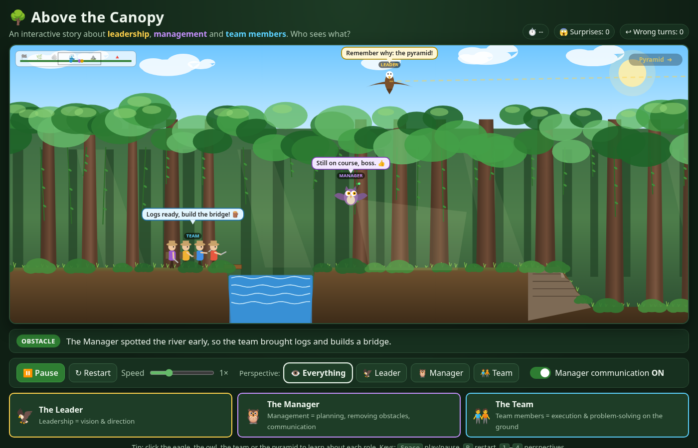
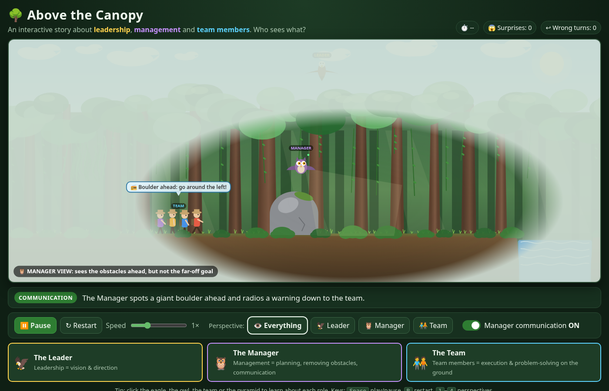

# 🌳 Above the Canopy

**An interactive animation about the difference between leadership, management and team members.**

A large forest with a tall canopy. A pyramid pokes out of the top of the trees far to the east: that's the goal.

| Role | Where they are | What they can see | What they do |
|---|---|---|---|
| 🦅 **Leader** | Flies *above* the canopy | Where the team started, and the pyramid (the goal) | **Vision & direction.** Sets the destination and keeps everyone pointed at it |
| 🦉 **Manager** | Flies *below* the canopy, above the team | The obstacles ahead: vines, a boulder, a river, a cliff | **Planning, removing obstacles, communication.** Scouts ahead and warns the team |
| 🧑‍🤝‍🧑 **Team** | Walks on the forest floor through vines and bushes | Only a few metres ahead | **Execution & problem-solving.** Cuts paths, builds bridges, climbs down cliffs |



## The teaching idea

Nobody can see the whole picture on their own:

- The **leader** can see the goal but not the boulders.
- The **manager** can see the boulders but not the goal.
- The **team** can see neither. They're down in the vines doing the work.

The journey works when vision flows down (leader ➜ manager) and warnings and plans flow down to the team (manager ➜ team).
Use the **Perspective** buttons to see the world through each role's eyes, and turn **Manager communication OFF**
to watch the same team in the same forest get surprised, take wrong turns and take much longer.



### Discussion prompts
1. What could the leader see that nobody else could? What couldn't they see?
2. When communication was off, what changed for the team? Was it the team's fault?
3. In your organisation, who is the "manager under the canopy"? How do the warnings reach the team?
4. What happens if the leader tries to do the manager's job, or the manager tries to do the team's?

## Controls

| Control | What it does |
|---|---|
| ▶ Play / ⏸ Pause | Start or stop the animation (keyboard: <kbd>Space</kbd>) |
| ↻ Restart | Start the journey again (<kbd>R</kbd>) |
| Speed slider | 0.25× to 3× |
| Perspective: Everything / Leader / Manager / Team | Fogs out what that role **can't** see (<kbd>1</kbd> to <kbd>4</kbd>) |
| Manager communication ON/OFF | When OFF, the manager still spots obstacles but never tells the team |
| Click the eagle, owl, team or pyramid | Opens an info card about that role |

The caption bar narrates each phase, and the stats at the top count **surprises** and **wrong turns**.
When the team reaches the pyramid, a summary lets you replay with communication flipped so you can compare.

## Run it

### Visual Studio
1. Clone: `git clone https://github.com/Metadata-Team-Member/AboveTheCanopy.git`
2. Open **`AboveTheCanopy.sln`** in Visual Studio 2026, or any Visual Studio version with the **.NET 10 SDK** and the *ASP.NET and web development* workload.
3. Press **F5**. The browser opens at `http://localhost:5131`.

### Command line
```bash
dotnet run --project src/AboveTheCanopy
# then open http://localhost:5131
```

### Online
**https://metadata-team-member.github.io/AboveTheCanopy/**

Right now the site is served from the `gh-pages` branch, which holds the published `wwwroot` output.
To publish automatically on every push to `main`, move `deploy/pages.yml` to `.github/workflows/pages.yml`
(pushing workflow files needs a token with the `workflow` scope), then set **Settings → Pages → Source** to **GitHub Actions**.
The workflow publishes the app, sets `<base href="/AboveTheCanopy/">`, and adds `.nojekyll` and a `404.html`.

## How it's built

- **Blazor WebAssembly** (standalone, .NET 10) for the page, controls, captions and role info cards (`src/AboveTheCanopy/Pages/Home.razor`, `Models/RoleInfo.cs`).
- A small **HTML5 canvas engine** in plain JavaScript (`wwwroot/js/canopy.js`) for smooth 60 fps animation, loaded as a module through JS interop.
- All the art is drawn with canvas shapes. There are no images, no external libraries and no CDNs, so it works offline.

```
AboveTheCanopy.sln
src/AboveTheCanopy/
  Pages/Home.razor        UI: canvas, controls, caption bar, info cards, summary
  Models/RoleInfo.cs      Teaching text for each role
  wwwroot/js/canopy.js    Animation engine: scene, agents, story, perspectives
  wwwroot/css/app.css     Styling
deploy/pages.yml             GitHub Pages workflow (move to .github/workflows/ to enable)
```

Want to change the story? The obstacle scripts live in `sequenceFor()` in `canopy.js`, with an "informed" and an "uninformed" version for each obstacle.
The captions and messages are plain strings, so they're easy to edit.

## License
[MIT](LICENSE)
