# 🌳 Above the Canopy

**An interactive animation about the difference between leadership, management and team members.**

A large Australian forest with a tall canopy. A pyramid pokes out of the top of the trees far to the east: that's the goal.
Time is measured like a real project, in **days**: the top bar counts *Day 1, Day 2...* until the koalas deliver.

| Role | Character | Where they are | What they can see | What they do |
|---|---|---|---|---|
| **Leader** | 🦅 Eagle | Flies *above* the canopy | Where the team is now, and the pyramid (the goal) | **Vision, priorities, backing the team & adapting.** Sets the destination, filters competing priorities, says YES to what the team needs (and protects their time), changes the plan when better information comes up from the ground |
| **Manager** | 🦉 Owl | Flies *below* the canopy, above the team | The obstacles ahead | **Planning, removing obstacles, communication up & down, coaching & delegating.** Scouts ahead, warns the team, coaches and delegates, passes ideas up, calls breaks, recognises wins, coordinates with other managers |
| **Team** | 🐨 Four koalas: Kip, Banjo, Matilda & Wattle | On the forest floor, cutting through the bush | Only a few metres ahead | **Execution, problem-solving & leading from the ground.** The everyday work, gathering materials, learning new skills, solving obstacles, reporting surprises, and spotting better ways to do things |

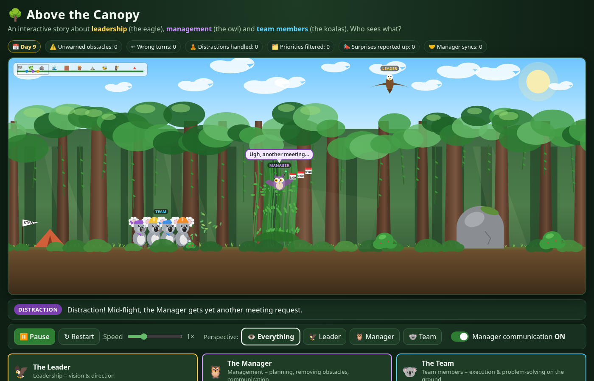

## The teaching idea

Nobody can see the whole picture on their own:

- The **leader** can see the goal but not the boulders.
- The **manager** can see the boulders but not the goal.
- The **team** can see neither. They're down in the bush doing the work.

The journey works when vision flows down (leader ➜ manager), warnings and plans flow down to the team (manager ➜ team), and requests and progress flow back up (team ➜ manager ➜ leader).
Use the **Perspective** buttons to see the world through each role's eyes, and turn **Manager communication OFF**
to watch the same koalas in the same forest get surprised, take wrong turns and take much longer (about 154 days instead of about 119).

## What happens on the journey

**The everyday work.** Between the big obstacles, the koalas keep stopping to cut through small bushes on the path: little pruning saws swinging, leaves flying.
That's the constant day-to-day work that nobody above the canopy sees.

**Eight obstacles,** each one different, each with a warned solution and a "nobody told us" version:

| # | Obstacle | When the Manager warned them | When communication is OFF |
|---|---|---|---|
| 1 | 🌿 Tangle of vines | Arrive with cutting tools and cut straight through | Get stuck, run all the way back for better tools |
| 2 | 🪨 Giant boulder | **Upskill:** a quick hammer-and-chisel training session, then break the rock down together | Bonk into it, push, back-track, then teach themselves by trial and error (slowly) |
| 3 | 🌊 Fast river | **Gather** logs from the bush and build a bridge | One koala wades in (splash!), then they scatter hunting for anything that floats |
| 4 | 🟫 Smelly bog | **Gather** flat stones and lay stepping stones | One koala sinks to its tummy, then they wander off for rocks and test wobbly stones |
| 5 | 🪵 Fallen giant log | Crawl through its hollow | Try to climb over it, slide off, trek along it |
| 6 | ⛰️ Cliff edge | **Gather** long vines, braid a rope, abseil at the marked spot | Wander the edge, then hunt for anything rope-like |
| 7 | 🐝 Bees' nest | Tiptoe past in silence | Stomp underneath, get chased by the swarm |
| 8 | 🧗 Rock wall | **Gather** straight poles and lash a ladder | Slide down bare-pawed, hunt for sticks, lash together a wobbly ladder |

When an obstacle is cleared, the caption says how many days it took. Unwarned obstacles also say what it would have taken
("Rock wall cleared, but going in blind took 6 days instead of about 3 days").

**Upskilling at the boulder: investing in team skills.** The boulder is too big to go around. With communication ON, the Manager's warning
comes with training: a whiteboard reads *🔨 HAMMER & CHISEL 101*, lightbulbs pop over the koalas, and they earn a 🎓 **UPSKILLED!** badge.
Then they spread around the rock and break it down together: rhythmic tapping, chips flying, cracks spreading, the boulder splitting into chunks,
then rubble they step over. With communication OFF, they bonk into it, push, back-track, and finally teach themselves (*TRIAL & ERROR...*, *SELF-TAUGHT*), much more slowly.

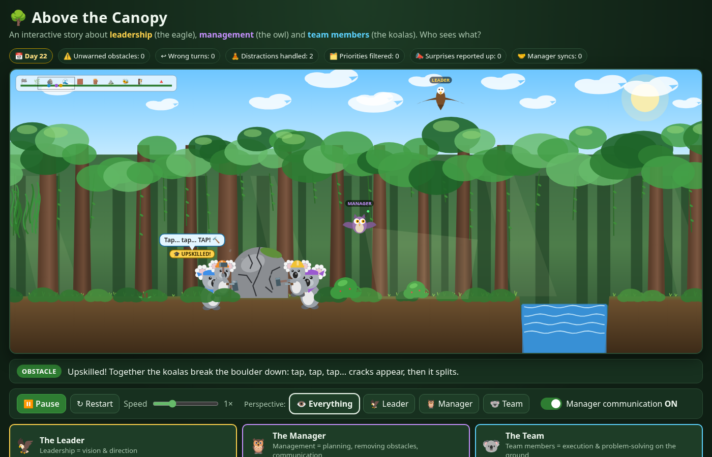

**Gathering materials.** When the koalas need logs (river bridge), flat stones (bog), planks (sinkhole), vines (cliff rope) or poles (ladder),
they fan out off the path into the bush, pick the materials up and carry them back in their arms, where a pile builds up and is used during the build.
With communication OFF they wander further, unsure what they're even looking for.

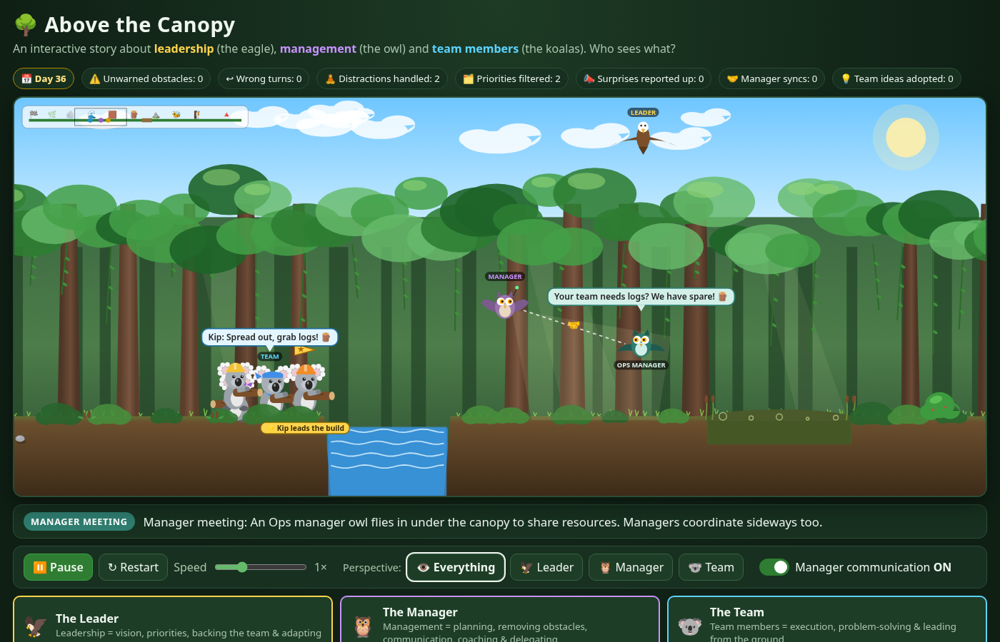

## New in v5: leaders back the team, managers grow people, team members lead too

**Meet the koalas.** Hover over a koala to see its name (the team info card lists them too):

| Koala | Look | Moment in the story |
|---|---|---|
| **Kip** | orange hard hat | Gets delegated the lead on the river bridge (⭐ pennant) |
| **Banjo** | blue bandana | Spots the creek-bed shortcut |
| **Matilda** | yellow hard hat | "Koala of the week" 🌿 for keeping everyone calm past the bees |
| **Wattle** | purple bandana, the smallest | Struggles with her saw and gets coached |

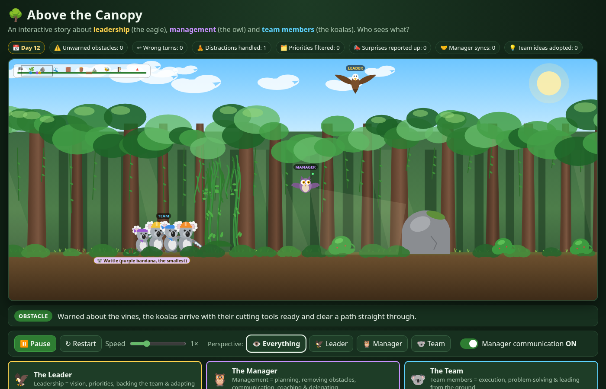

**Managers grow people: coaching.** Early on, Wattle lags behind, her saw stuck in a bush. With communication ON, the owl drops down
beside her (caption tag **COACHING**): *"You've got this, Wattle! Hold it like this. ✂️"*. She gets it, catches up, and earns a 💪 badge.
With communication OFF nobody notices, and she keeps struggling.

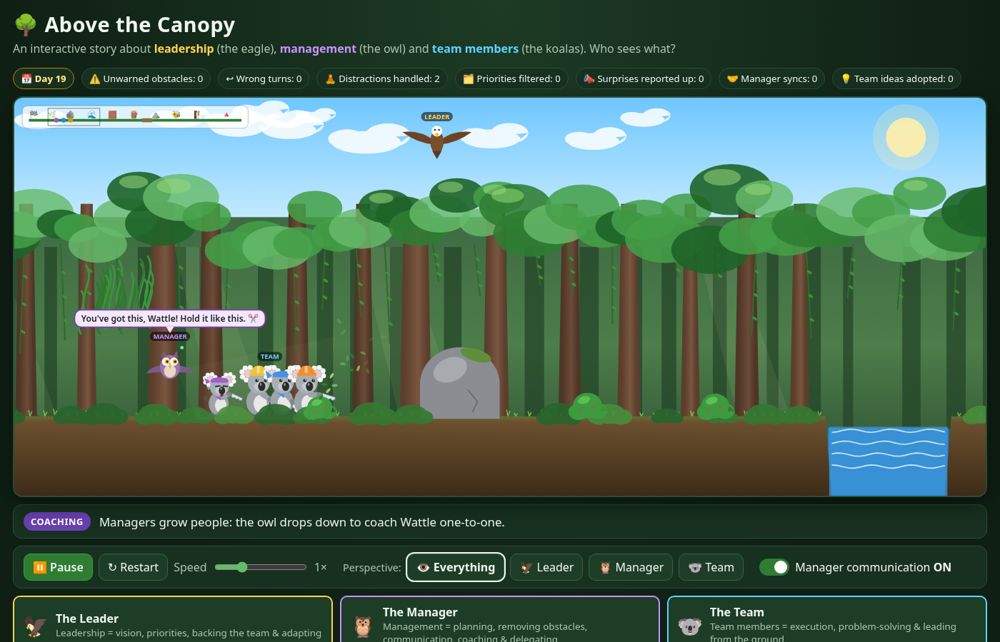

**Managers grow people: delegation.** At the river the owl says *"Kip, you lead the bridge build! ⭐"* (tag **DELEGATION**).
Kip carries a ⭐ pennant and directs the gathering ("Kip: Spread out, grab logs!"), and gets a "Great leading, Kip!" when the bridge is done.

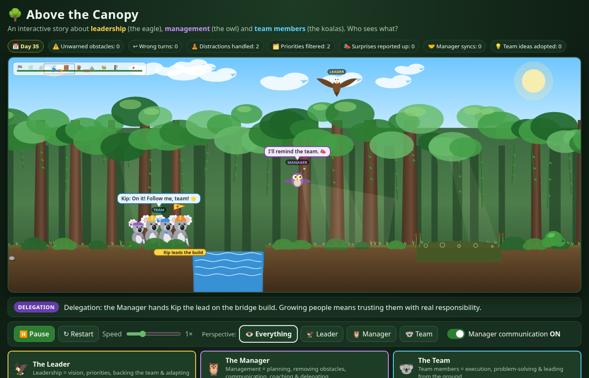

**Leaders back the team** (tag **LEADER SUPPORT**). Twice the eagle visibly sides with the koalas:
- At the second eagle meeting, the Board asks for a picnic and another project wants to borrow two koalas. The Leader pushes back:
  *"The koalas need that time: the picnic can wait! 🛡️"*
- When the gum tree falls, the koalas ask for saws and safety gear. The Leader says *"Yes! Sending saws and safety gear down now. 🪂"*,
  and a supply crate floats down on a parachute through a gap in the canopy (🪂 **SUPPLIES ARRIVED**).

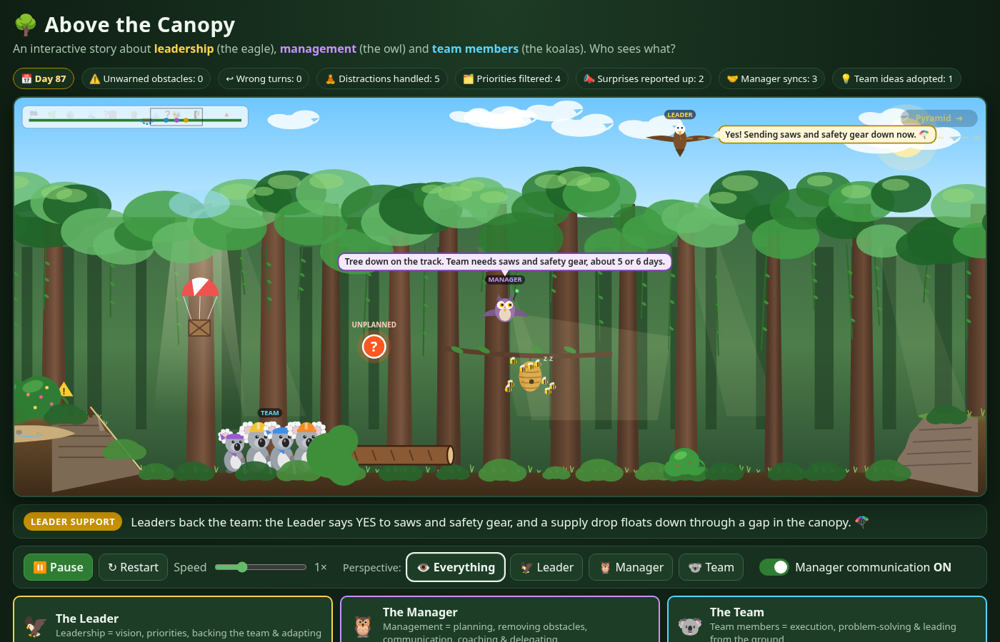

**Team members lead too, and leaders adapt** (tags **TEAM IDEA** and **COURSE CORRECTION**). Hacking through thick lantana, Banjo spots a dry creek bed
running alongside: *"There's a shortcut along the creek bed! 💡"*. The owl takes it up to the eagle, and the eagle changes the plan from ground information:
the beam re-aims at the creek, the minimap shows the new dashed route, and the eagle says *"New info from the ground. We'll take the creek route; it saves N days."*
(N is worked out from the lantana still left, usually 4 to 6 days.) Credit flows back down: *"Creek route approved! Great idea, Banjo! 🌟"*.
The top bar counts **💡 Team ideas adopted**. With communication OFF, Banjo's idea goes nowhere ("Should we tell someone?") and the koalas hack through every lantana bush.

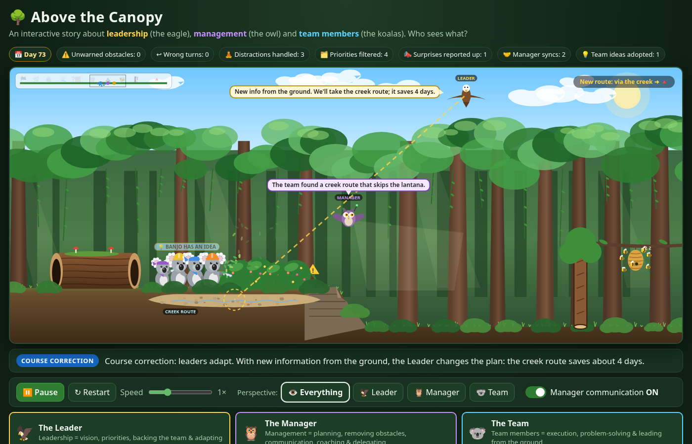

**Celebrating small wins.** After the bees, the owl names Matilda **Koala of the week** and a gum leaf drifts down onto her chest. 🌿

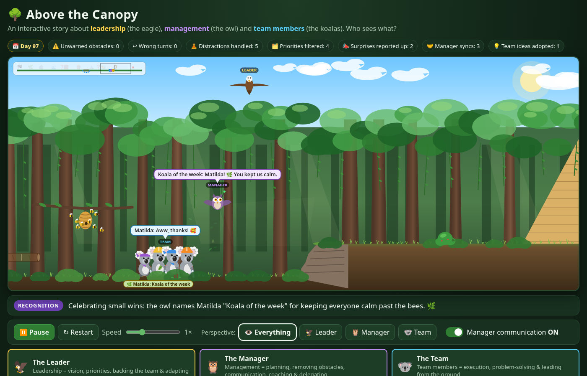

**Trust and wellbeing** (tag **WELLBEING**). After the toughest stretch (cliff, bees, snake, rock wall) the owl calls *"Take five, team"*.
The koalas sit down around a billy, drink water and munch eucalyptus leaves. It costs about 4 days, and the caption says why that's worth it:
a sustainable pace beats burnout. Afterwards they're ⚡ **REFRESHED**. With communication OFF, nobody calls a break: the koalas droop,
sweat drops fly, and they slow right down to the finish (😓 **EXHAUSTED**). The break days come back and more.

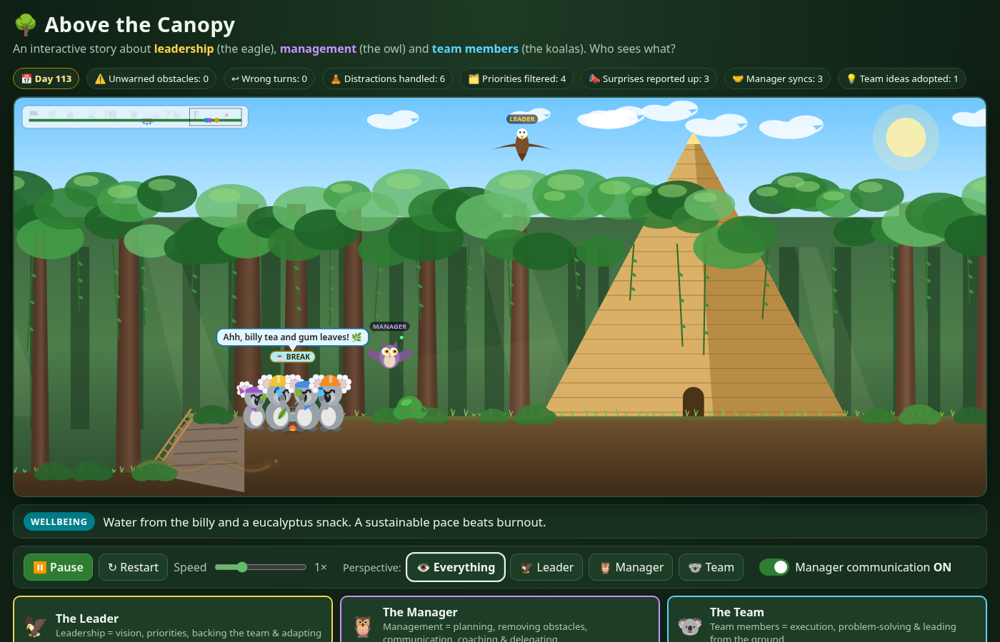

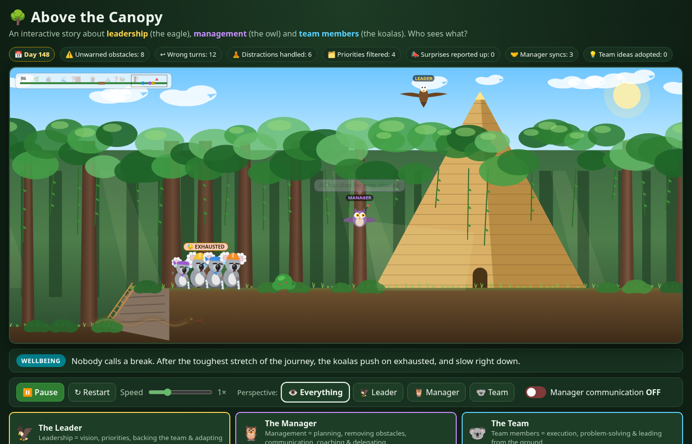

**Reflection.** At the finish, the summary has a **💬 Reflect** button that shows three workplace questions (different ones for ON and OFF runs).

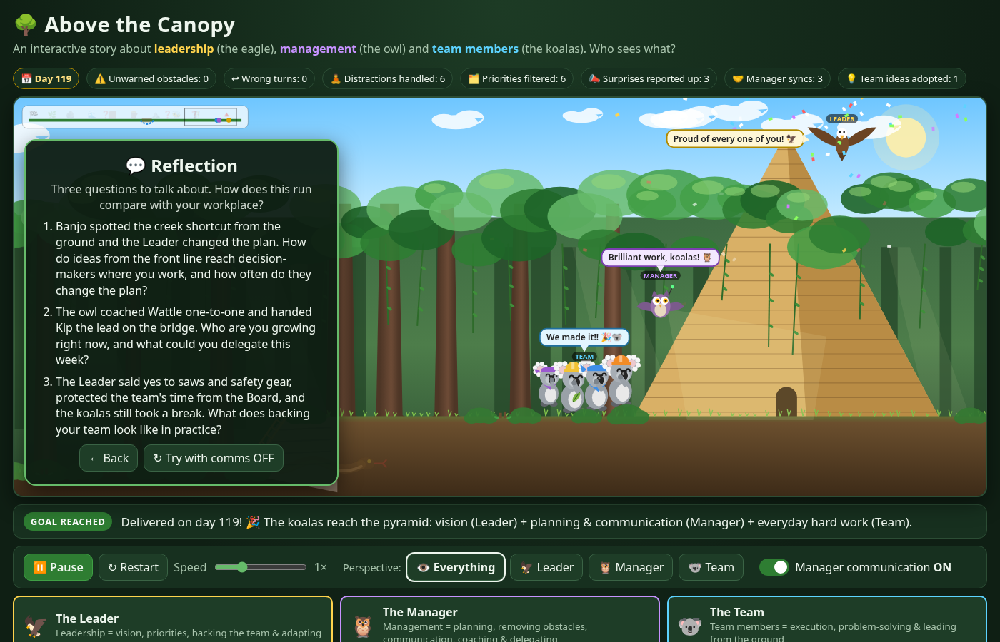

**Captions queue up.** Captions now wait their turn: a meeting caption stays on screen until the meeting ends, and important captions
(meetings, surprises, coaching, course corrections) are never cut off by routine narration.

**Rubble stays.** After the boulder is broken up, the rubble is swept to the side of the path and stays visible.

## New in v6: chapters, teaching mode and sound

### 📖 Chapters (teachable moments)
Open **📖 Chapters** in the controls bar (or press <kbd>C</kbd>) to see every chapter with a short title and its teaching point, and tap one to jump straight to it.
The button always shows the current chapter. **⏭** (or <kbd>N</kbd>) jumps to the next chapter. The list is a scrollable panel that works by touch on a phone (it slides up from the bottom).

| # | Chapter | Teaching point |
|---|---|---|
| 1 | The vision | Only the Leader can see both where the team is now and the pyramid |
| 2 | Passing the direction down | Leader ➜ Manager: the vision becomes a plan |
| 3 | Everyday work | The bush hacking nobody up top sees |
| 4 | The vines: a warning in time | Warned early, the right tools are ready |
| 5 | Coaching Wattle | Managers grow people |
| 6 | The boulder & upskilling | Training first makes the work faster |
| 7 | Competing priorities | The first eagle meeting: yes to the pyramid, park the rest |
| 8 | The river & delegation | Kip gets the lead on the bridge build |
| 9 | Manager meetings | Managers coordinate sideways (the Ops owl shares logs) |
| 10 | Surprise! The sinkhole | Bottom-up communication, and the answer back down |
| 11 | The bog | Knowing exactly what to gather |
| 12 | Leader support: protecting time | "The koalas need that time: the picnic can wait!" |
| 13 | The fallen log | A small tip saves a long detour |
| 14 | Banjo's idea & course correction | Team members lead too; leaders adapt |
| 15 | The cliff | The Manager scouts the safe spot |
| 16 | Supply drop: leaders back the team | The Leader says YES to saws and safety gear |
| 17 | The bees & Koala of the week | Tiptoe past, then celebrate a small win |
| 18 | The snake | Some delays you wait out safely |
| 19 | The rock wall | Preparation pays off |
| 20 | Rest break | A sustainable pace beats burnout |
| 21 | Final priorities | New asks arrive even near the end |
| 22 | The pyramid & reflection | Vision + planning & communication + everyday work |

With communication OFF, the chapter list and the teaching cards describe what goes wrong instead (for example *"Nobody notices Wattle struggling"*).

**How a jump works.** Jumping restarts the story and silently fast-forwards the simulation to the chapter's first moment, with sound and screen updates muted.
The simulation steps at a fixed rate and its randomness is seeded, so a jump to a chapter always lands in exactly the same state (in about a twentieth of a second on a laptop).

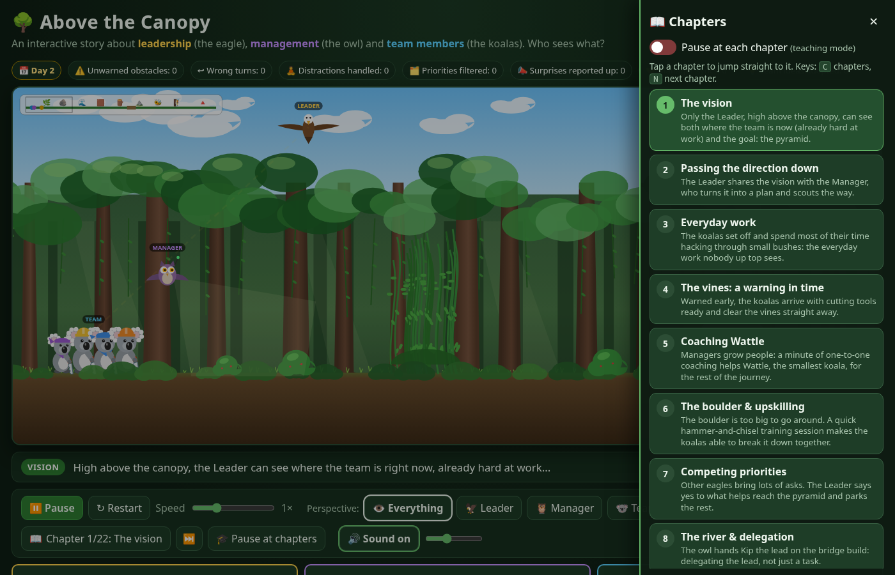

### 🎓 Teaching mode: pause at each chapter
Turn on **🎓 Pause at chapters** (in the controls bar or at the top of the chapters panel). At the start of every chapter the story pauses and a
**Teachable moment** card shows the teaching point and one or two discussion questions. **▶ Continue** carries on; **Stop pausing** turns teaching mode off.
The last chapter goes straight to the finish summary and its 💬 Reflect panel instead.

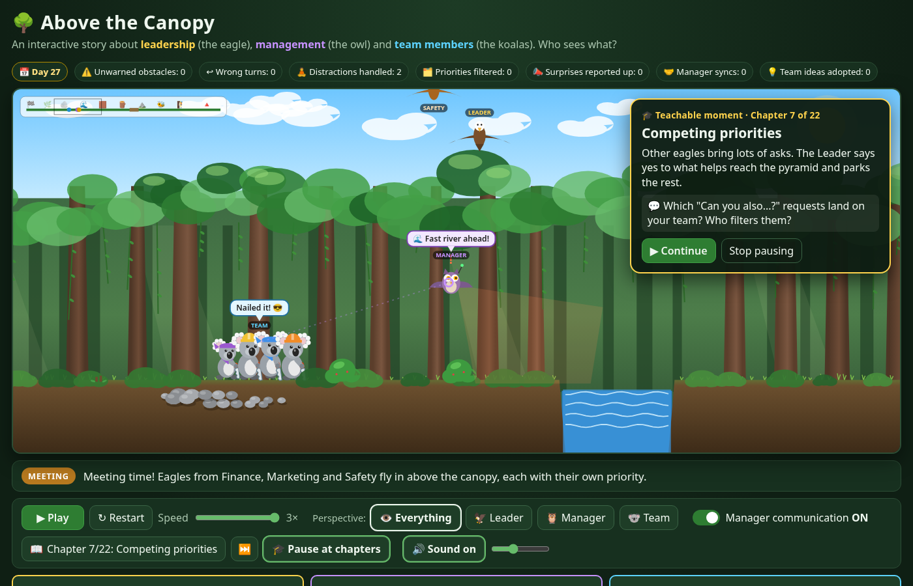

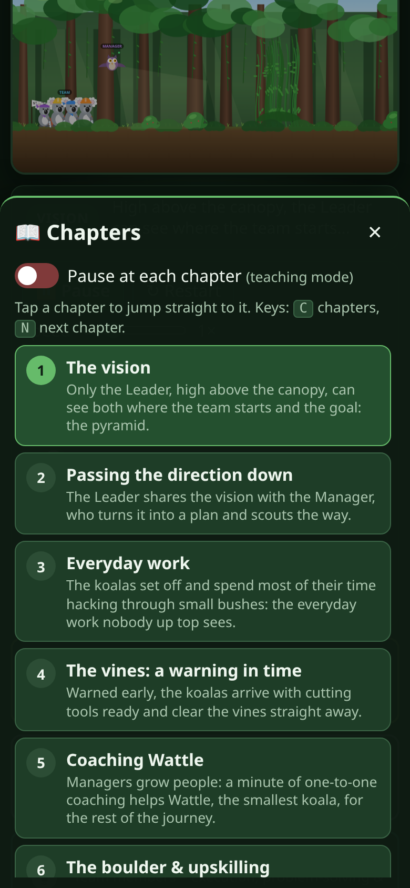

### 🔊 Sound
Every sound is **generated in the browser with the Web Audio API**: there are no audio files, no CDNs and no licensing issues, and it works offline.
Sound is on by default but only starts after your first tap, click or key press (browser autoplay rules; on iOS Safari it unlocks on the first touch).
**🔊 Sound on / 🔇 Sound off** (or <kbd>M</kbd>) and the volume slider are in the controls bar, and your choice is remembered on this device.
Pausing the story pauses the audio. At high speeds repeated sounds are thinned out, and every sound has its own rate limit so nothing gets spammy.
The mix is deliberately gentle for a classroom: soft envelopes, a compressor and a low-pass filter on the master output.

| Moment | Sound |
|---|---|
| The forest | Soft wind and leaf rustle, bird chirps, a distant kookaburra-ish laugh, cicada swells, running water near the river (a trickle in the creek bed) |
| Messages | Chimes on every message pulse: falling notes for Leader ➜ Manager and Manager ➜ Team, a rising arpeggio for escalations up the chain |
| Leader & Manager | A soft eagle cry and wing flaps; owl hoots when the Manager spots a hazard and when a visiting owl arrives; a whoosh when visiting eagles fly in |
| Work | Saw rasps for bushes, rhythmic hammer-and-chisel taps at the boulder, log and plank thunks, stone clacks in the bog, rope creaks at the cliff, vine snips |
| Distractions | Magpie squawk, an email ping storm, thunder and a wind gust, a mozzie whine, a calendar ding for the meeting request, a branch snag |
| Surprises | An alert sting, plus a sinkhole rumble, a tree creak and crash, or a snake hiss |
| Obstacles (comms OFF) | A splash in the river, a squelch in the bog, a bonk on the boulder, the angry bees' swarm, and an echo when a call goes unanswered |
| Support & growth | Parachute whoosh and a thud when the supply drop lands; sparkles for Upskilled, coached Wattle, Kip's lead, Banjo's idea and Koala of the week; a soft chord when the Leader backs the team |
| Rest break | Campfire crackle and the billy bubbling |
| Finish | A small fanfare and confetti pops |

## More of the journey

**Distractions happen, so refocus.** The Leader and the Manager get distracted too, veer off course, then refocus on the goal.
Each distraction is narrated, and the top bar counts **Distractions handled**:

- 🦅 Leader: swooping magpies, an "URGENT!!!" reply-all email storm, a storm front and wind gust.
- 🦉 Manager: a "Sync about the sync" meeting request, a cloud of mozzies, a snag of branches and vines.

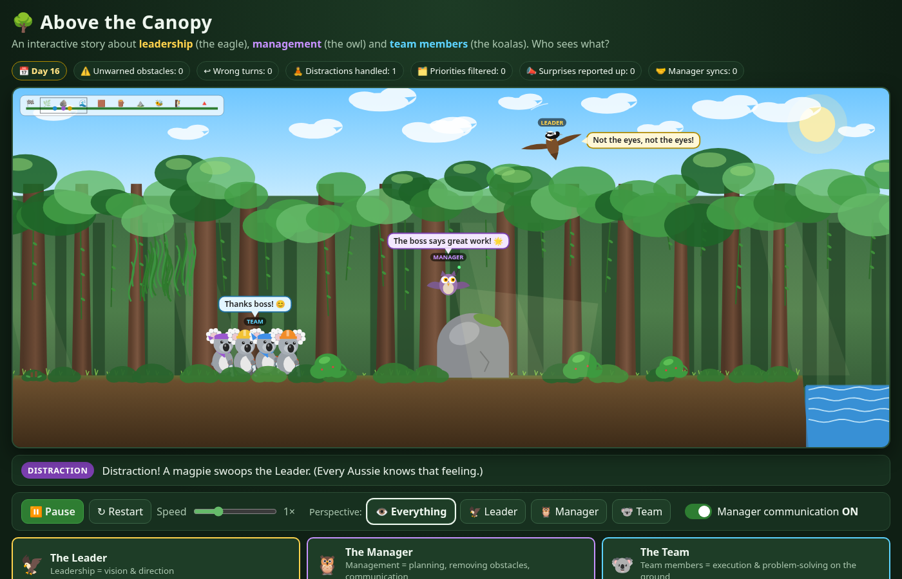

**Manager meetings: sideways coordination.** Three times, while the koalas are busy gathering materials, another owl flies in under the canopy
for a short manager-level meeting (caption tag **MANAGER MEETING**). A dashed 🤝 link joins the two owls while they talk, then the visitor flies off
and the Manager refocuses on the team (a green line re-locks onto the koalas). The top bar counts **🤝 Manager syncs**.

| Visiting owl | Topic | The conversation |
|---|---|---|
| 🟢 Ops manager | Sharing resources | "Your team needs logs? We have spare!" · "Yes please! Drop them by the river." |
| ⚪ PMO | Status sync | "Status sync?" · "River done, bog in progress. On track." · "Great, I'll update the roadmap." |
| 🟠 Project manager B | Coordinating between teams | "Can we share your rope after?" · "Sure, once my koalas are down the cliff." · "Need a ladder later?" |

**Lots of communication.** The leader checks in with the manager and gets progress reports after every obstacle.
The manager briefs the koalas and checks on them. The koalas ask for things ("Need more rope!", "Pass more stones down the line!") and get answers.
Wins get recognised ("Great work, koalas!") and celebrated. With communication OFF, the koalas' calls go unanswered ("Is anyone up there?").

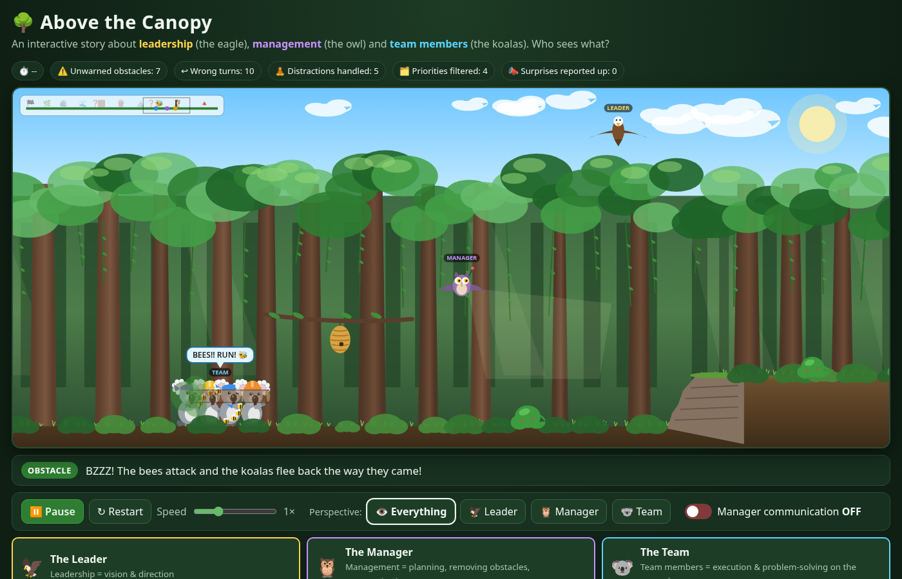

**Eagle meetings: filtering competing priorities.** Three times on the journey, other eagles fly in above the canopy and circle the Leader,
each with a priority card. The Leader weighs them up, says ✅ **yes** to the one that helps the team reach the pyramid,
and **parks** the others ("Not now; the pyramid comes first"). The visitors fly off, and the Leader puts the beam back on the goal ("Keep it going").
The top bar counts **Priorities filtered**.

| Meeting | Visiting eagles and their asks | ✅ Accepted (supports the pyramid) |
|---|---|---|
| 1 | 💰 Finance: "Budget cuts?" · 🎨 Marketing: "Urgent: rebrand!" | 🦺 Safety: "Safety gear for koalas" |
| 2 | 🏛️ Board: "Can you also run the picnic?" · 📁 Other project: "Lend us two koalas?" | 🗺️ Product: "Better map to the pyramid" |
| 3 | 🚀 Strategy: "New initiative!" · 👥 HR: "Can you also do a survey?" | 🤝 Customers: "Pyramid opening: still on?" |

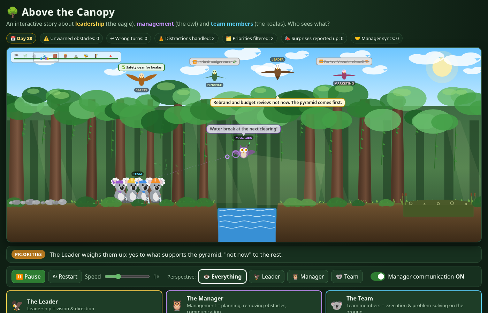

**Surprises: things nobody saw coming.** Three events happen that the Manager *couldn't* have spotted, even with communication ON.
They're marked with a pulsing orange **❓ UNPLANNED** sign and a red **SURPRISE** caption tag.
The koalas stop and report **up the chain**: koalas ➜ Manager ("Manager! A sinkhole just opened up!"), then Manager ➜ Leader
("Unplanned sinkhole. Team needs planks, about a week."). The Leader answers ("Safety first, take the week. Goal stays the same."),
the answer travels back down, and the team solves it together. The top bar counts **Surprises reported up**.

| # | Surprise | Reported up and answered | Fix |
|---|---|---|---|
| 1 | 🕳️ Sinkhole opens in the track | "Safety first, take the week. Goal stays the same." | Gather planks from the bush and lay them across |
| 2 | 🌳 A gum tree falls across the path | "Yes! Sending saws and safety gear down now. 🪂" (a supply drop lands) | Saw it up with the new gear and roll it away |
| 3 | 🐍 Big brown snake on the track | "No rush. Let it pass safely. Goal stays the same." | Wait quietly until it slithers off |

When a surprise is handled, the caption says how many days it cost ("The sinkhole cost 7 days, but everyone knew why and the goal stayed the same").

With communication OFF, the koalas' calls go unanswered ("...hello?"). They handle each surprise alone, with a false start and a slower fix.

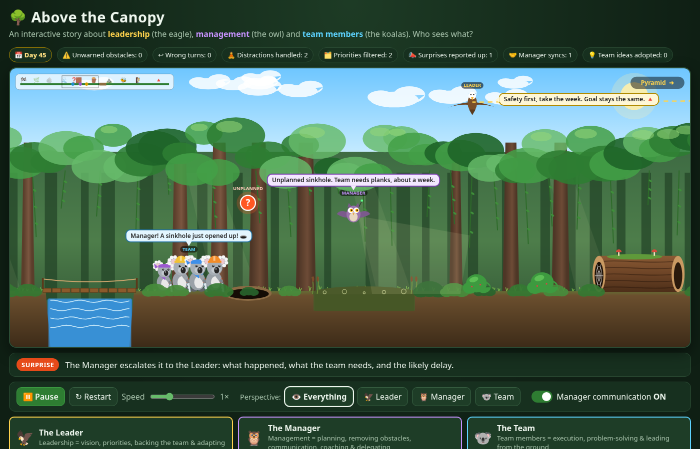

### How long is a run? (days and minutes)
Project time: **1 project day = 2 seconds of animation at 1× speed.**

| | Project time | Real time at 1× | Unwarned obstacles | Wrong turns | Surprises reported up | Manager syncs |
|---|---|---|---|---|---|---|
| Communication **ON** | **about 119 days** | about 4 min (238 s) | 0 | 0 | 3 | 3 |
| Communication **OFF** | **about 154 days** | about 5 min (306 s) | 8 | 12 | 0 | 3 |

With communication ON the run also has 1 team idea adopted (the creek route saves 4 to 6 days) and 1 rest break (about 4 days).
With communication OFF there's no idea and no break, but the exhausted koalas slow right down.

The finish summary shows "Delivered in N days" and compares it with the other mode: your own result if you've run both in this session, otherwise the typical figure.
For example: "Without communication the same project usually takes about 154 days: 35 days lost."

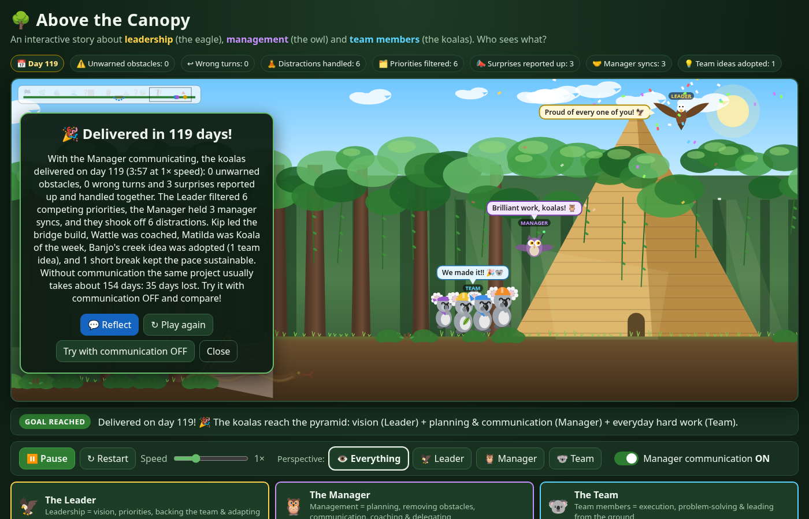
Use the speed slider (0.25× to 3×) to fit your session.

### Discussion prompts
1. What could the leader see that nobody else could? What couldn't they see?
2. When communication was off, what changed for the koalas? Was it their fault?
3. Most of the koalas' time went on small bushes, not big obstacles. What's the "bush hacking" in your team's week?
4. What are your magpies, meeting requests and reply-all storms? How do you get back to the goal?
5. In your organisation, who is the "manager under the canopy"? How do the warnings reach the team, and how do requests get back up?
6. Which "Can you also...?" requests land on your leaders? How do they decide what to park?
7. When something nobody planned for happens, how fast does the news travel up, and does the answer come back down?
8. The boulder only broke once the koalas learned a new skill. Where would an hour of training save your team days?
9. Who are the "other owls" your managers coordinate with? What do they share?
10. When did a leader last say YES to something your team needed, or push back to protect your time? What difference did it make?
11. Wattle was struggling and the owl coached her. Who in your team is quietly struggling, and who notices?
12. Kip led the bridge build. What could you delegate this month, not just a task but the lead?
13. Banjo saw the creek bed because he was in the lantana. How do ideas from the ground reach your leaders, and do they get credit?
14. When did your plan last change because of new information? Was that seen as a failure or as good leadership?
15. The break cost 4 days; skipping it cost more. Where is your team running without a break?
16. Who would you give the gum leaf to this week, and why?

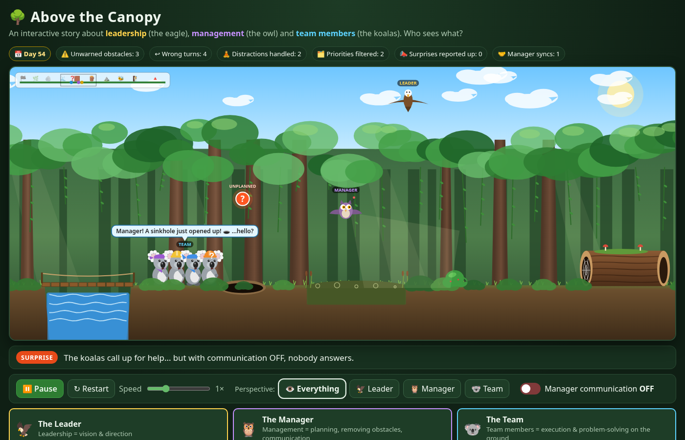

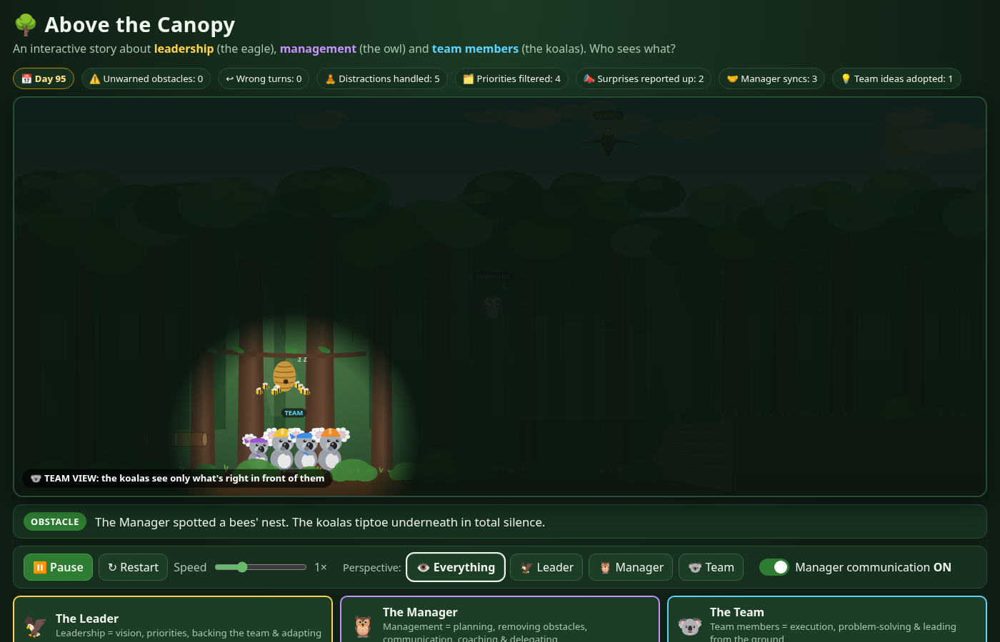

## Controls

| Control | What it does |
|---|---|
| ▶ Play / ⏸ Pause | Start or stop the animation (keyboard: <kbd>Space</kbd>) |
| ↻ Restart | Start the journey again (<kbd>R</kbd>) |
| Speed slider | 0.25× to 3× |
| Perspective: Everything / Leader / Manager / Team | Fogs out what that role **can't** see (<kbd>1</kbd> to <kbd>4</kbd>) |
| Manager communication ON/OFF | When OFF, the manager still spots obstacles but never tells the koalas |
| Click the eagle, owl, koalas or pyramid | Opens an info card about that role |
| Hover over a koala | Shows its name (Kip, Banjo, Matilda or Wattle) |
| 📖 Chapters | Lists every chapter; tap one to jump to it (<kbd>C</kbd>) |
| ⏭ | Next chapter (<kbd>N</kbd>) |
| 🎓 Pause at chapters | Teaching mode: pause at each chapter with a teachable moment |
| 🔊 Sound on/off + volume | Procedural sound effects and forest ambience (<kbd>M</kbd>); remembered on this device |
| 💬 Reflect (at the finish) | Three discussion questions for the run you just watched |

The caption bar narrates each phase (with a red **SURPRISE** tag for unplanned events and an amber tag for meetings). The stats at the top count:
**📅 Day** (project time), **⚠️ Unwarned obstacles** (planned obstacles the koalas hit with no warning), **↩ Wrong turns**, **🧘 Distractions handled**,
**🗂️ Priorities filtered** (asks the Leader parked or declined), **📣 Surprises reported up**, **🤝 Manager syncs** and **💡 Team ideas adopted**.
The info cards scroll (with a visible scrollbar), so all the text is readable in a small window.

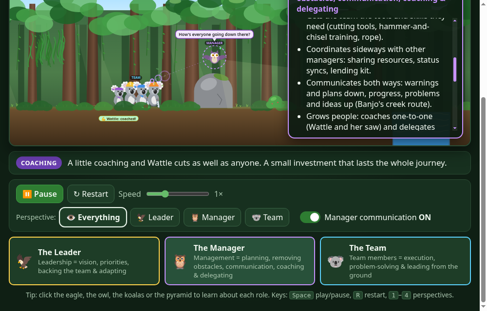
When the team reaches the pyramid, a summary lets you replay with communication flipped so you can compare.

## Run it

### Visual Studio
1. Clone: `git clone https://github.com/Metadata-Team-Member/AboveTheCanopy.git`
2. Open **`AboveTheCanopy.sln`** in Visual Studio 2026, or any Visual Studio version with the **.NET 10 SDK** and the *ASP.NET and web development* workload.
3. Press **F5**. The browser opens at `http://localhost:5131`.

### Command line
```bash
dotnet run --project src/AboveTheCanopy
# then open http://localhost:5131
```

### Online
**https://metadata-team-member.github.io/AboveTheCanopy/**

Right now the site is served from the `gh-pages` branch, which holds the published `wwwroot` output.
To publish automatically on every push to `main`, move `deploy/pages.yml` to `.github/workflows/pages.yml`
(pushing workflow files needs a token with the `workflow` scope), then set **Settings → Pages → Source** to **GitHub Actions**.
The workflow publishes the app, sets `<base href="/AboveTheCanopy/">`, and adds `.nojekyll` and a `404.html`.

## How it's built

- **Blazor WebAssembly** (standalone, .NET 10) for the page, controls, captions and role info cards (`src/AboveTheCanopy/Pages/Home.razor`, `Models/RoleInfo.cs`).
- A small **HTML5 canvas engine** in plain JavaScript (`wwwroot/js/canopy.js`) for smooth 60 fps animation, loaded as a module through JS interop.
- All the art is drawn with canvas shapes. There are no images, no external libraries and no CDNs, so it works offline.

```
AboveTheCanopy.sln
src/AboveTheCanopy/
  Pages/Home.razor        UI: canvas, controls, caption bar, info cards, summary
  Models/RoleInfo.cs      Teaching text for each role
  Models/Chapters.cs      The 22 chapters: story mark, title, teaching point, questions
  wwwroot/js/canopy.js    Animation engine: scene, agents, story, perspectives, chapters
  wwwroot/js/sound.js     Procedural Web Audio sound effects and ambience
  wwwroot/css/app.css     Styling
deploy/pages.yml             GitHub Pages workflow (move to .github/workflows/ to enable)
```

Want to change the story? Everything is in `canopy.js`:
- `OB_DEFS` sets the obstacle layout, and `sequenceFor()` holds the obstacle scripts, with an "informed" and an "uninformed" version of each.
- `DISTRACTIONS` holds the leader and manager distractions (when they trigger, and what they say).
- `MEETINGS` holds the eagle meetings: visiting eagles, their asks, which one is accepted, and the Leader's answers.
- `MGR_MEETINGS` holds the manager-level owl meetings (which obstacle they happen at, the visiting owl's colours and the conversation).
- `SEC_PER_DAY` sets the project-time scale (2 s = 1 day). `GATHER_SPOTS` and `gatherPose()` control how the koalas fan out to gather materials.
- `SURPRISE_DEFS` holds the unplanned events and the full up-the-chain conversation for each one. `surpriseSeq()` and `upChain()` run them.
- `LEADER_TALK`, `MANAGER_CHECKIN`, `RECOGNITION` and `CHEERS` hold the routine messages.
- `WALK_SPEED_INFORMED` / `WALK_SPEED_UNINFORMED` and `makePathBushes()` control the pacing.
- `KOALAS` holds the koalas' names, colours and hats. `COACH_X`, `LANTANA`, `CREEK` and `BREAK_X` place the coaching moment, the lantana patch, the creek route and the rest break.
- `coachSeq()`, `startIdea()` / `adoptIdea()`, `startRecognition()` and `startBreak()` run the v5 moments. `whenFree()` waits until the Manager is free (no meeting, distraction or task) before starting one, so they never talk over each other.
- `mark()` records story moments; a chapter starts at the first moment named in `Models/Chapters.cs`. `jumpTo()` restarts and fast-forwards (fixed 1/60 s steps, seeded randomness) to a chapter.
- `sound.js` holds every sound as a small synth recipe (`SFX`), the ambient forest bed (`buildAmbience()`, `tick()`), the per-sound rate limits (`RATE`) and the saved on/off and volume settings. `audioTick()` and `ambLevels()` in `canopy.js` connect it to the story.
- `caption()` queues captions with a priority and an optional hold (`pumpCaptions()` shows them), so meeting and surprise captions are never cut off.

Note: .NET 10 fingerprints static files at build time, so after editing `canopy.js` outside Visual Studio, rebuild (or use `dotnet watch`).

## Licence
[MIT](LICENSE). Copyright (c) 2026 Metadata-Team-Member.
